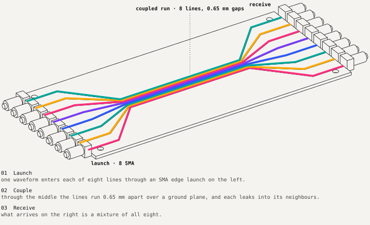

# delaytensor

Two attempts to compute with delay lines, simulated and benched.

**Delay Tensor** treats a bundle of coupled transmission lines as a fixed reservoir in front of a linear readout. Its one clear win, temporal XOR (0.724 raw, 0.995 reservoir), turned out under ablation to belong to the per-slot tanh, not the coupling. The recurrence matches ngspice to 5.27e-16.

**DLNN** trains ternary {-1, 0, +1} weights into the taps of an LC delay line, so the board's pick-and-place file is the model. It scores 0.878 on the simulated board line and 0.17 on the board as first drawn, until a gain bug is fixed, with a 0.6-point spread over 1,000 simulated boards.

Nothing here has been fabricated or measured. Every page says which of simulated, emulated, designed or pending applies. The experiments, tests and run data were produced by Claude Code sessions, mostly on the Fable model, under the author's direction.



## Read

| Start with | For |
|---|---|
| [docs/story.md](docs/story.md) | how the project got here: mainline and waypoints |
| [docs/architecture.md](docs/architecture.md) | both halves, the benches and the data flow on one page |
| [docs/design/](docs/design) | detailed design: [delay-tensor](docs/design/delay-tensor.md), [benches](docs/design/benches.md), [dlnn](docs/design/dlnn.md) |
| [AGENTS.md](AGENTS.md) · [llms.txt](llms.txt) | working here as an agent |

## Layout

```text
packages/delay-tensor/   reservoir simulation, readouts, experiments, CLI (uv workspace member)
benches/                 ngspice equivalence, RLCG lines, transient, scikit-rf, ERA extraction
packages/dlnn/           ternary tapped-delay-line network, tiers V/E/C/P, board-as-code (own venv)
packages/dlnn-paper/     notebooks, article draft, board renders, claim checker
docs/                    story, architecture, design docs, figures
```

## Quick start: Delay Tensor

```bash
uv sync --all-packages
uv run --all-packages delay-tensor classify --config packages/delay-tensor/configs/tensor_8x64.yaml --seeds 1234,1235,1236
uv run --all-packages delay-tensor xor --config packages/delay-tensor/configs/tensor_8x64.yaml
uv run --all-packages delay-tensor mnist --config packages/delay-tensor/configs/mnist_8x784.yaml
uv run --all-packages pytest
```

Each run writes `results/<run_id>/` with `report.html`, `metrics.json`, `runs.csv`, `observations.txt` and the exact `config.yaml`. MNIST takes a few minutes; features go to a float32 memmap, not RAM. The benches need the optional group: `uv sync --all-packages --group bench`, with ngspice reachable through `NGSPICE_LIBRARY_PATH`.

| Experiment (3 seeds) | Raw | Tensor | Delta |
|---|---|---|---|
| Six-way classification | 0.847 ± 0.016 | 0.861 ± 0.022 | +0.014 ± 0.006 |
| Temporal XOR | 0.724 ± 0.024 | 0.995 ± 0.009 | +0.271 ± 0.024 |
| MNIST | 0.9136 ± 0.0003 | 0.9146 ± 0.0012 | +0.0011 ± 0.0014 |

## Quick start: DLNN

```bash
cd packages/dlnn
./setup.sh                      # WITH_LLM=0 skips the optional local LLM build
.venv/bin/python -m pytest -q   # torch-dependent tests skip without the train extra
```

Full commands and versions: [packages/dlnn/docs/reproducibility.md](packages/dlnn/docs/reproducibility.md). The verify notebook `packages/dlnn-paper/notebooks/00_verify.ipynb` re-checks every printed number against its data.

## Archive

The original June 2026 `phase-lattice-sim` workspace lives outside this repository, with its own history, and is kept as a reference only.
