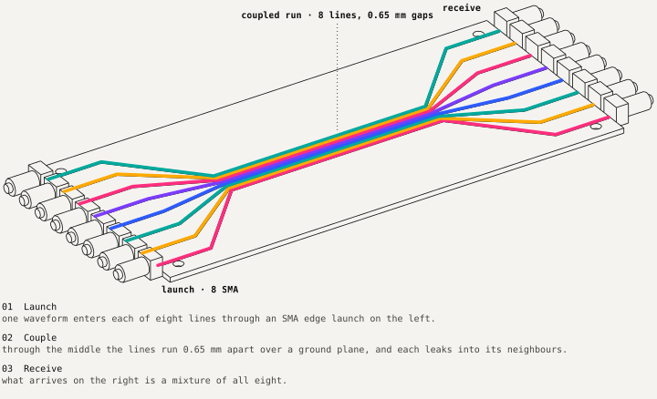
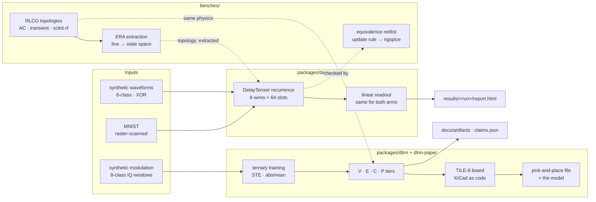
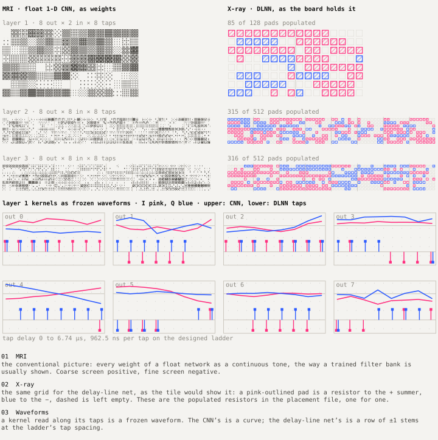

# Architecture

One question runs through the repository: can a delay line do a neural network's work? It is asked twice. **Delay Tensor** asks whether a fixed bundle of coupled lines, left to leak into each other, turns a waveform into features a linear readout can use. **DLNN** asks whether the taps of a line can *be* the weights, trained to {−1, 0, +1} and soldered as resistors. A set of circuit benches sits between the two and keeps both honest against ngspice.

Everything here is **simulated**, **emulated** (Verilog RTL) or **designed, not fabricated**. Nothing has been measured on hardware.



## System context



The two halves share no code. They share a method: every number is produced by a script that writes a file, and every claim points at that file.

## Packages

| Path | Role | Entry point | Truth lives in |
|---|---|---|---|
| `packages/delay-tensor` | Fixed coupled-line reservoir, three experiments, self-contained reports | `delay-tensor {classify,xor,mnist}` | `results/<run>/metrics.json` |
| `benches/` | ngspice equivalence of the recurrence; RLCG line models, AC and transient benches, scikit-rf referee, ERA extraction | `pytest benches/tests` (bench group) | test assertions; `benches/01-equivalence.ipynb` |
| `packages/dlnn` | Ternary tapped-delay-line net; tiers V, E, C, R, P; board generation | `run.py`, `hw/board/*.py` | `out/<run>/tiers/*.json`, `hw/board/params.json` |
| `packages/dlnn-paper` | Reader notebooks, the article, board renders, claim checker | `scripts/check_article_numbers.py` | `docs/artifacts/data/claims.json` |
| `archive/` | The June 2026 phase-lattice harness, kept as reference | — | its own git history |

## Data flow, Delay Tensor

```mermaid
flowchart LR
    C[config.yaml<br/>tensor · coupling · loss · readout] --> L[load_config<br/>validated dataclasses]
    D[datasets.py · mnist.py] --> S[stratified split<br/>25% held out per class]
    L --> DT[DelayTensor.run<br/>tanh·λ·x + u·p + σ(m)·k₁·nbr]
    S --> DT
    S --> RAW[raw samples]
    DT --> F[traces → features<br/>W × S per waveform]
    F --> RO1[LinearReadout]
    RAW --> RO2[LinearReadout<br/>identical C, split, seed]
    RO1 --> SUM[Summary<br/>mean ± sd over seeds]
    RO2 --> SUM
    SUM --> OUT[report.html · metrics.json · runs.csv<br/>observations.txt · config.yaml]
```

The design invariant is **readout parity**: the raw arm and the reservoir arm get the same readout class, hyperparameters, split and seed. The only thing that differs is the feature generator, so any difference in accuracy belongs to the reservoir. Details: [design/delay-tensor.md](design/delay-tensor.md).

## Data flow, DLNN

```mermaid
flowchart LR
    G[modrec generator<br/>16,000 / 4,000 windows] --> TR[train.py<br/>ternary STE]
    TR --> NPZ[model .npz<br/>W ∈ {−1,0,+1}]
    NPZ --> V[V · NumPy<br/>ideal or board-line FIR]
    NPZ --> E[E · 8-bit fixed point<br/>= Verilog RTL]
    NPZ --> C[C · ngspice<br/>tile netlist]
    NPZ --> P[P · scikit-rf ABCD<br/>parasitics · Monte Carlo]
    V & E & C & P --> CMP[compare.json<br/>paired blocks · knees]
    NPZ --> BRD[derive_params → gen_tile<br/>→ PCB → freerouting → fab]
    BRD --> CPL[CPL: populated RXP / RXN<br/>= non-zero weights]
    CPL -. tapmap check .-> NPZ
```

Each tier writes one canonical record, `tiers/<tier>.json` plus `.npz` arrays, under the `dlnn-tier/1` schema in `packages/dlnn/dlnn/contract.py`. Comparison only ever reads those records, so a tier can be replaced without touching the others. The board path closes a loop the simulators cannot: `board/tapmap.json` maps every (layer, output, input, tap) to its resistor reference, and its populated count (85, 315, 316) equals the model's non-zero weights. Details: [design/dlnn.md](design/dlnn.md).



## Benches

The benches answer one question each.

| Bench | Question | Result |
|---|---|---|
| Equivalence | Does the NumPy recurrence mean what a circuit would compute? | ngspice and NumPy agree to 5.27e-16 over 2,048 unrolled stages |
| Topologies + AC | Are the line models right? | ngspice matches the analytic chain matrix to 1e-11–1e-13; the ladder sits within ≈1% of the distributed line |
| Transient | Does the time domain agree with the frequency domain? | through path within 0.58% of peak; flight 464.8 ps against 481.6 ps predicted |
| scikit-rf | Is the closed-form microstrip right? | Z₀ within 0.45% (thin trace), 2.0% with 35 µm copper |
| Extraction | Can a line become the reservoir? | plumbing exact on synthetic systems; not yet closed on a real line |

Details: [design/benches.md](design/benches.md).

## Interfaces

- **Configs** are YAML, loaded into frozen dataclasses that refuse inconsistent values (for example `loop_period_ns ≠ slots × slot_dt_ns`, or an extracted topology with spectral radius above 1).
- **Run directories** are append-only: `results/<timestamp>-<config>-<experiment>/` and `out/<run_id>/`. A run never edits another run.
- **Reports** are static HTML with inline SVG and no network fetches, so a run stays readable without its environment.
- **Claims** in the DLNN article resolve to JSON fields; `check_article_numbers.py` fails if page and data disagree.

## Status

| Component | State |
|---|---|
| Delay Tensor classify / XOR / MNIST | simulated, three seeds, reproducible digit for digit |
| Equivalence and RF benches | simulated, in the test suite |
| Extracted line as reservoir | plumbing built; not run end to end |
| DLNN tiers V, E, P | simulated; E bit-exact against RTL on phase-1 nets |
| DLNN tier C on the board net | pending |
| Carrier and layer-1 tile | routed, 0 DRC violations; not fabricated |
| Full tiles (layers 2, 3) | placed, not routed |

Read next: [story.md](story.md) for how the repository got here, or the design docs for how each part works.
