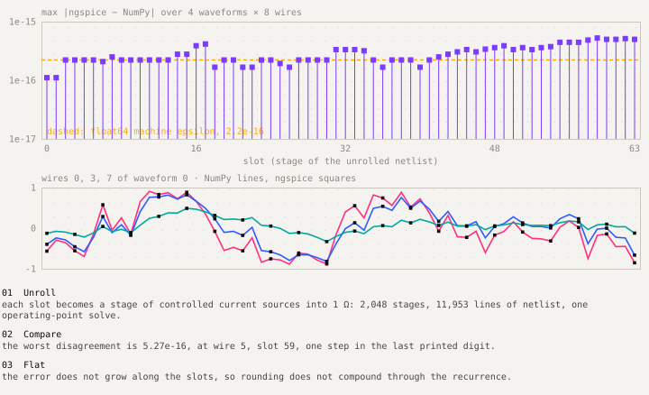
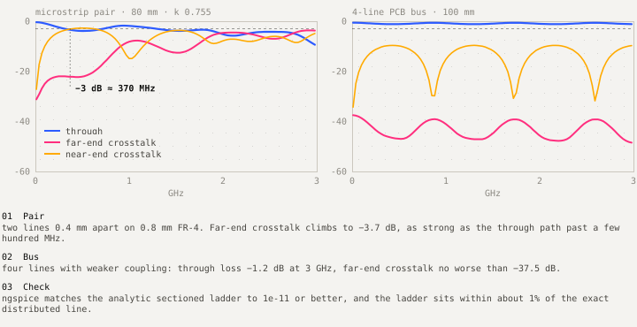
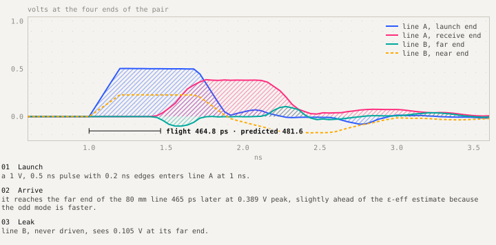

# Design: circuit benches

`benches/` keeps the simulated reservoir honest against a circuit simulator, and builds the real lines it stands in for. PySpice is GPL-3.0, so only `benches/spice_runner.py` imports it, and the bench dependencies (`PySpice`, `scikit-rf`) sit in a separate uv group. ngspice is reached through `NGSPICE_LIBRARY_PATH`.

## Equivalence: the recurrence as a circuit

A circuit has no slot clock, so `netlist.py` unrolls each slot into space as its own stage. Every additive term of the update becomes a voltage-controlled current source into a 1 Ω summing resistor, so the summed current reads as a voltage, and tanh is a behavioural source on the far side.

```text
R_0_5_59   u0_5_59 0 1                       * 1 Ω: volts = summed amps
Gdc_0_5_59 0 u0_5_59 q0_5_58 0 0.995         * decay × own previous state
Gnl_0_5_59 0 u0_5_59 q0_4_58 0 0.0609        * σ(m) × k1, left neighbour
Gnr_0_5_59 0 u0_5_59 q0_6_58 0 0.0609        * same gain, right neighbour
Gdr_0_5_59 0 u0_5_59 d0_59 0 0.4286          * input × this wire's profile
B_0_5_59   q0_5_59 0 V=tanh(v(u0_5_59))      * the limiter
```

The 8 × 64 tensor with a batch of four becomes 2,048 stages (11,953 netlist lines, 7,592 controlled sources) solved as one operating point with tolerances near machine precision.



The worst disagreement is 5.27e-16 and does not grow along the slots. While it was being written, the bench found a real bug in the netlist's tanh gating. It proves the translation of the equations and nothing about hardware.

## Lines: RLCG topologies

`topologies.py` describes three lines by per-unit-length R, L, C and G matrices, cut into pi sections by `rf_netlist.py`.

| Line | Conductors | Length | Sections | Built from |
|---|---|---|---|---|
| `mcl` | 4 | 100 mm | 64 | electrical: tridiagonal C, L falling off with distance |
| `microstrip_pair` | 2 | 80 mm | 48 | geometry: 1.5 mm lines, 0.4 mm gap, 0.8 mm FR-4 |
| `lc_ladder` | 2 | 10 mm | 4 | lumped: the coarsest case the pipeline must survive |

Two details are easy to get wrong and are encoded in the code:

- The shunt capacitor is the **row sum** of C, not its diagonal; the diagonal would inflate the line's capacitance by the whole mutual term.
- Series R and L go through a private mid-node, because two elements between the same node pair are in parallel in SPICE.

Loss (skin-effect R, dielectric G = ωC·tan δ) is linearised at 1 GHz and is honest only near that frequency.



## Time domain and referee

`transient.py` launches a 1 V, 0.5 ns pulse, solves `.tran` at 10 ps, recovers S from the response and compares it with the AC sweep over 0.1–1.9 GHz. `rf_char.py` uses scikit-rf's `MLine` as an independent check of the closed-form microstrip.



## Extraction: from a line to a reservoir

`extract.py` fits a discrete state-space model `(A, B, C, D)` to a line's impulse response by Ho–Kalman / ERA (Hankel SVD of the Markov parameters) and saves it for `coupling.topology: extracted`. Unit tests recover synthetic systems to 1e-12. On the 4-line bus's 10 ps transient, low orders fit poorly (41% relative error at order 8, 21% at 16) and spectral radii come out at 1.001–1.003, which the reservoir refuses. The line's picosecond scale is also about forty times finer than the 20 ns slot. Closing that gap is open work.

## Tests

`benches/tests` holds 103 tests: netlist generation, equivalence, topology matrices, AC agreement with the analytic ladder, convergence at second order in section count, transient agreement, scikit-rf agreement, and extraction round trips. They skip cleanly without the bench group.
