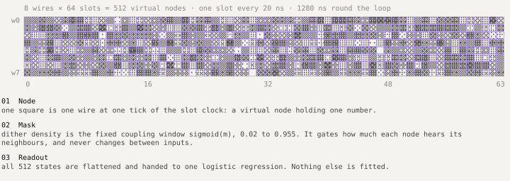
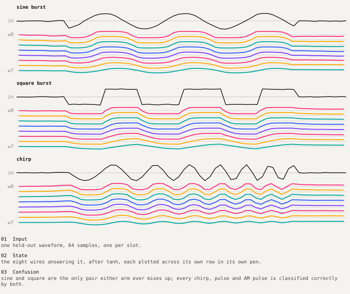
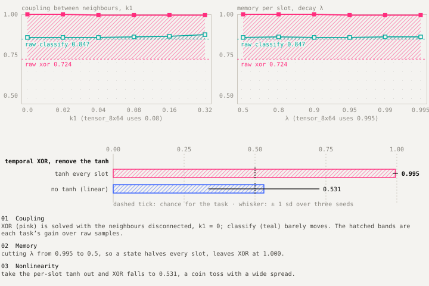

# Design: Delay Tensor

`packages/delay-tensor` simulates a bundle of coupled transmission lines as a fixed reservoir and measures whether its states give a linear readout more to work with than the raw waveform. In its own design notes it is "a physical metaphor, not a circuit solver". The benches check it against one.

## Model

The tensor is a grid of **wires × slots**. A wire is one conductor; a slot is one tick of a 20 ns clock. Each (wire, slot) cell holds one state value, a virtual node.



For every slot `s`, all wires at once:

```text
nbr[w]       = k1·(state[w−1] + state[w+1]) + k2·(state[w−2] + state[w+2])     open ends: missing neighbour = 0
candidate[w] = λ·state[w] + drive[s]·profile[w] + σ(m[w,s])·nbr[w]             mask_mode: modulated
candidate[w] = λ·state[w] + drive[s]·profile[w] + nbr[w] + g·m[w,s]             mask_mode: additive
candidate   += noise_std·N(0, 1)
state[w]     = tanh(candidate[w])                                               or identity
traces[w,s]  = state[w]
```

- `profile` falls linearly from 1.0 to 0.2 across the wires, so each wire hears the input at its own gain.
- `m ~ N(0, 1)` is fixed by `mask_seed`; `σ(m)` spans 0.02–0.955 for seed 0 on 8 × 64. It is the same for every input.
- With `location: edge_and_state`, features are `tanh(traces)`, flattened to `W·S` values; `rightmost_wire` keeps only the last wire, as a single-probe control.
- `topology: extracted` replaces the recurrence with `state ← A·state + σ(m)·B[:,0]·u`, with `(A, B)` loaded from an `.npz` produced by `benches/extract.py`. The loader refuses `A` with spectral radius above 1 + 1e-6.



## Modules

| Module | Responsibility |
|---|---|
| `config.py` | Frozen dataclasses (`TensorConfig`, `CouplingConfig`, `LossConfig`, `NonlinearityConfig`, `ReadoutConfig`) and `load_config` / `save_config`. Validates cross-field invariants. |
| `reservoir.py` | `DelayTensor.run(waveforms) → TensorRunResult` (traces, features, health). The only place the recurrence lives. |
| `datasets.py` | Six-class waveforms (amplitudes matched on purpose), temporal XOR, per-waveform normalisation, `stratified_split`. |
| `mnist.py` | Cached canonical MNIST and `raster_scan` (28 × 28 → 784 slots, one pixel per slot). |
| `readout.py` | `LinearReadout` (StandardScaler → multinomial logistic regression, C = 1) and `StreamingLinearReadout` (same model by SGD, `alpha = 1/(C·n)`, float32 memmap features). |
| `experiments/` | `run_classify`, `run_xor`, `run_mnist`; each returns a `Summary` with both arms over all seeds. |
| `metrics.py` | Accuracy, confusion matrix, `Spread` (mean ± sample sd). |
| `report.py`, `svg.py` | Static HTML reports with hand-written SVG charts and an animated field view; no plotting library, no network. |
| `cli.py` | `delay-tensor {classify,xor,mnist} --config … --seeds …` → `results/<run>/`. |

## Invariants

1. **Readout parity.** Both arms share readout class, C, split, seed and (for MNIST) batch boundaries. Anything else would make the comparison meaningless.
2. **Fixed reservoir.** Nothing in `DelayTensor` is fitted. Seed dependence comes only from the noise term and the data, split and readout seeds.
3. **Validated geometry.** `loop_period_ns = slots × slot_dt_ns`; timing jitter is refused rather than silently ignored.
4. **Health is reported, not hidden.** `saturation_fraction` (share of |state| > 0.99) is written to every run; above 25% the run is marked saturated.

## Results and what they mean

| Experiment | Raw | Tensor | Delta |
|---|---|---|---|
| Six-way classification (tensor_8x64, 3 seeds) | 0.847 ± 0.016 | 0.861 ± 0.022 | +0.014 ± 0.006 |
| Temporal XOR (tensor_8x64, 3 seeds) | 0.724 ± 0.024 | 0.995 ± 0.009 | +0.271 ± 0.024 |
| MNIST (mnist_8x784, 3 seeds) | 0.9136 ± 0.0003 | 0.9146 ± 0.0012 | +0.0011 ± 0.0014 |



Single-knob ablations show the XOR win does not need coupling (k1 = 0 gives 1.000) or long memory (λ = 0.5 gives 1.000), and does need the per-slot tanh (identity gives 0.531 ± 0.196). With pulses at fixed positions, the task tests a fixed nonlinear expansion rather than memory. A version with jittered pulse times would test the coupling.

## Tests

`packages/delay-tensor/tests` covers config validation, recurrence shapes and determinism, readout parity, SVG rendering, the extracted-topology loader and MNIST raster scanning. Run with `uv run --all-packages python -m pytest -q` (see the root README for the full suite).
