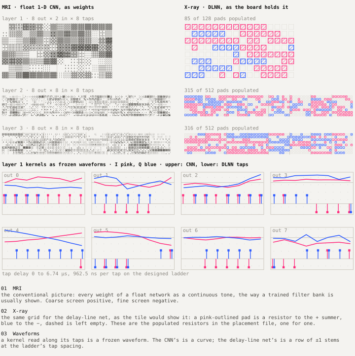
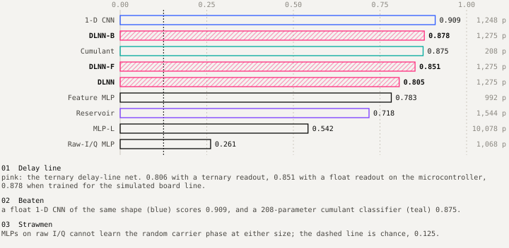
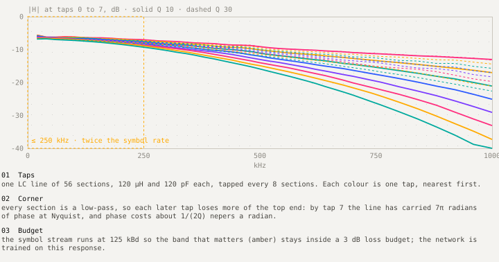
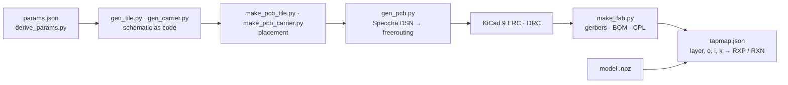
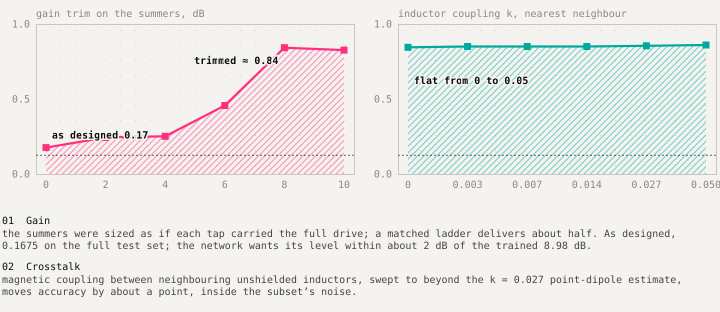
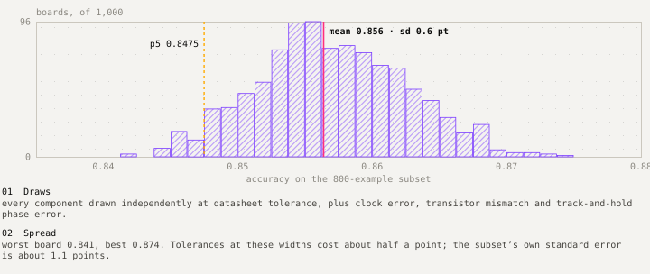

# Design: DLNN

`packages/dlnn` is a ternary tapped-delay-line network: each layer is a 1-D convolution whose taps are points on a delay line and whose weights are {−1, 0, +1}, held as which resistors are fitted. `packages/dlnn-paper` is its reader-facing twin: notebooks that regenerate the article's data, the article itself, the board renders and a claim checker. The package's own docs go deeper; this page is the map.

| Read next | For |
|---|---|
| [`packages/dlnn/docs/architecture.md`](../../packages/dlnn/docs/architecture.md) | module-level architecture |
| [`packages/dlnn/docs/tiers.md`](../../packages/dlnn/docs/tiers.md) | what each fidelity tier models and omits |
| [`packages/dlnn/docs/contract.md`](../../packages/dlnn/docs/contract.md) | the `dlnn-tier/1` record, field by field |
| [`packages/dlnn/docs/fixed_point_spec.md`](../../packages/dlnn/docs/fixed_point_spec.md) | the E tier's bit-true arithmetic |
| [`packages/dlnn-paper/docs/honesty.md`](../../packages/dlnn-paper/docs/honesty.md) | what is simulated, what is designed, what is pending |

## Layer

```text
u[o, n] = Σ_i Σ_k  W[o, i, k] · x[i, n − k·d]       W ∈ {−1, 0, +1}
y[o, n] = gain · tanh( (u[o, n] + b[o]) / Vsat )
```

Width 8 is 2 → 8 → 8 → 8 channels, eight taps, 1,152 ternary weights. The board network uses d = 1 throughout (receptive field 22 samples), because a tile has one fixed tap spacing. Training uses absmean ternarisation forward and a straight-through estimator backward (`model/ternary.py`, `model/train.py`); pooling and the 8-class readout run digitally.

On hardware: +1 is a 10 kΩ resistor from the tap to the output's "+" summer, −1 to the "−" summer, 0 is both footprints left empty. A difference amplifier subtracts the summers and drives a matched NPN pair, whose transfer is tanh with width 2V_T.



## Pipeline

`dlnn/pipeline.py` runs: dataset + model → tiers in order → float reference → `compare.json` → figures → commentary → database. Tiers are modules under `dlnn/tiers/`, each producing a `contract.TierResult`; `tiers/common.py` holds shared scoring (accuracy, macro-F1, mean KL against V, agreement).

| Tier | Module | Runs | Omits |
|---|---|---|---|
| V | `virtual.py` | ideal NumPy, optionally through the board line's FIR | everything physical except the line |
| E | `emulated.py` | 8-bit fixed point, bit-for-bit against `hw/rtl/tdl_layer.v` | analog effects |
| C | `circuit.py`, `circuit_board.py` | ngspice on the KiCad-exported tile netlist | layout, crosstalk, noise |
| P | `parasitics.py` | scikit-rf ABCD cascade with parasitics, mutual inductance, Monte Carlo | EM and layout |
| R | `rf.py` | RF channel of the phase-1 coax study | retired to the appendix |

`compare.py` pairs blocks across tiers and finds sweep knees along the axes listed in `contract.SWEEP_AXES` (tolerances, clock error, stage SNR, crosstalk k, gain trim, temperature).



## Line and board

The line is an LC ladder of 56 sections (120 µH, 120 pF; Z₀ = 1 kΩ; 120 ns a section; ideal cut-off 2.65 MHz), tapped every 8 sections. Each section is a low-pass, so later taps lose more of the top end. The symbol stream runs at 125 kBd to stay inside a 3 dB budget, and the board network is trained on the simulated response of this line, not an ideal delay.



The board is generated as code under `packages/dlnn/hw/board/`:



`tapmap.json` is the hinge: the populated resistors in the CPL equal the model's non-zero weights, layer by layer (85, 315, 316). The carrier and the reduced layer-1 tile are routed with 0 DRC violations; the full layer-2 and layer-3 tiles are placed, not routed.

## Where the simulation found the design wrong



As designed, the summers' feedback resistors assume each tap carries the full drive; a matched ladder delivers about half. The P tier scores 0.17 as designed and 0.87 at the trained level of 8.98 dB; the fix is feedback and bias resistors about 2.9× larger. Inductor crosstalk swept to k = 0.05 moves accuracy by about a point.



## Tests and checks

`packages/dlnn/tests` covers the contract, the tiers, the fixed-point arithmetic, the model and the board scripts; the model tests skip when torch is not installed. `packages/dlnn-paper/notebooks/00_verify.ipynb` re-checks every value the article prints against its data file.
