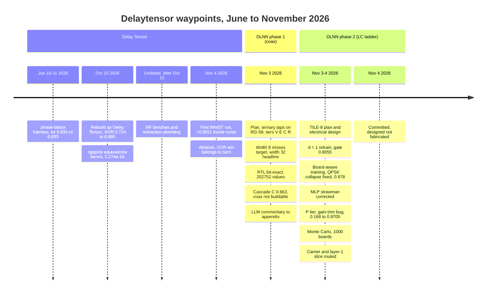
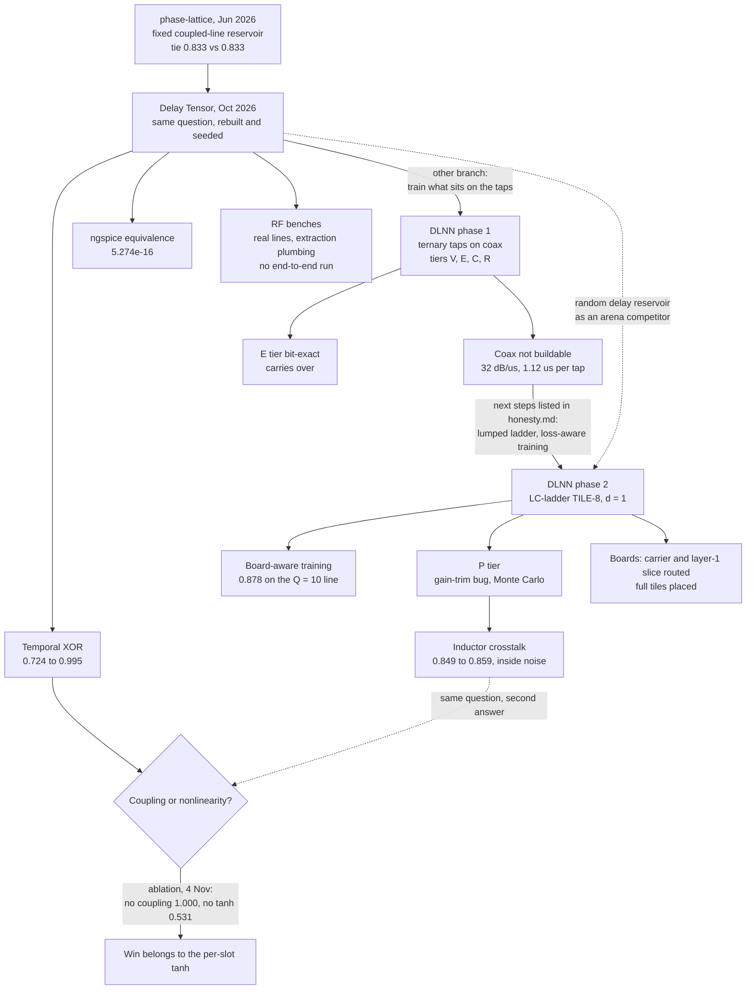

# Delaytensor: a project history

Two attempts to compute with delay lines, run between June and November 2026. The first, Delay Tensor, asked the crosstalk between coupled lines to do the work and found its one clear win (temporal XOR, 0.724 to 0.995) belonged to a per-slot tanh. The second, DLNN, trains ternary weights into the taps of a delay line and ends on a board that is designed, simulated and routed in part, and not fabricated.

Everything below comes from the project's own records: build logs, plans, design notes, run outputs and git history. Paths are relative to this file unless marked as outside the repository. Where a date is not in the records, the entry says so. The experiments, tests and run data were produced by Claude Code sessions, mostly on the Fable model, under the author's direction.

## Waypoints

| # | Date | Waypoint | Number that carried it | Source |
|---|---|---|---|---|
| W01 | 2026-06-10 to 06-11 | phase-lattice harness: first and only result is a tie | reservoir 0.833, raw 0.833 (one seed) | archive `observations.txt` (outside repo) |
| W02 | 2026-10-10 | Rebuilt as Delay Tensor: three archive bugs found, PyTorch dropped | XOR 0.724 ± 0.024 raw, 0.995 ± 0.009 reservoir (3 seeds) | [README](../packages/delay-tensor/README.md), [design.md](../packages/delay-tensor/docs/design.md) |
| W03 | 2026-10-10 | SPICE equivalence bench: update rule unrolled into ngspice | max error 5.274e-16 over 2,048 stages | [tools.md](../packages/delay-tensor/docs/tools.md), [01-equivalence.ipynb](../benches/01-equivalence.ipynb) |
| W04 | undated (after 2026-10-10, uncommitted) | RF benches: three real line topologies and an extraction path | ngspice vs sectioned ladder 1e-11 to 1e-13; no end-to-end extracted run | [benches/](../benches/), fact sheet (outside repo) |
| W05 | 2026-11-04 | First MNIST run: eight times the features, a tenth of a point | +0.0011 ± 0.0014 (tensor − raw); MLP 0.9786 | fact sheet (outside repo) |
| W06 | 2026-11-04 | Ablation: coupling off, tanh off | XOR 1.000 with no coupling; 0.531 ± 0.196 with no tanh | fact sheet (outside repo) |
| W07 | 2026-11-03 | DLNN phase 1 planned: ternary taps on coax, four fidelity tiers | 1,216 ternary weights, 8-class modulation recognition | [plan.md](../packages/dlnn/docs/plan.md) |
| W08 | 2026-11-03 | Width 8 misses its target; width 32 becomes the headline | w8 ternary 76.3 % at ≥ 10 dB against an 85 % target; 8PSK at 0 % | [build-log.md](../packages/dlnn/docs/build-log.md), [build-log-M1.md](../packages/dlnn/docs/build-log-M1.md) |
| W09 | 2026-11-03 | E tier: RTL bit-exact against the fixed-point model | 202,752 chained layer values, 0 mismatches (w32) | [build-log-M2a.md](../packages/dlnn/docs/build-log-M2a.md), [results.md](../packages/dlnn-paper/docs/results.md) |
| W10 | 2026-11-03 | Coax cascade runs; most of C's gap traced to a gain rule; coax judged not buildable | C 0.663 with per-layer trim, 0.804 with none, V 0.863 | [honesty.md](../packages/dlnn-paper/docs/honesty.md), [circuit_extraction.md](../packages/dlnn-paper/docs/circuit_extraction.md) |
| W11 | 2026-11-03 | LLM commentary demoted to an appendix | 0 of 5 injected divergences found without the Python-computed list | [honesty.md](../packages/dlnn-paper/docs/honesty.md) |
| W12 | 2026-11-03 | Phase 2 planned: LC-ladder TILE-8, d = 1, the CPL is the model | ladder of 56 × (120 µH, 120 pF), 120 ns a section | [phase2_plan.md](../packages/dlnn/docs/phase2_plan.md) |
| W13 | 2026-11-03 | TILE-8 electrical design: inductor chosen, filter and end caps changed | tap-spacing ripple 93 % → 29 %; ringing 23 % → 8.8 % (lossless bound) | [board_design.md](../packages/dlnn-paper/docs/board_design.md) |
| W14 | 3 to 4 Nov 2026 (not dated finer) | Retrained at d = 1 for the board; arena of competitors | gate passed at 0.8055; float CNN 0.909, cumulant 0.875 | [build-log-P2-M1b.md](../packages/dlnn/docs/build-log-P2-M1b.md) |
| W15 | 3 to 4 Nov 2026 (not dated finer) | Board-aware training, QPSK collapse, worst-class selection | QPSK 0.000 → 0.690; 0.878 on the Q = 10 line | [build-log-P2-M1b.md](../packages/dlnn/docs/build-log-P2-M1b.md) |
| W16 | 3 to 4 Nov 2026 (not dated finer) | MLP strawman corrected | raw-I/Q MLPs 0.261 / 0.542 after tuning; feature MLP 0.783 at 992 params | [build-log-P2-M1b.md](../packages/dlnn/docs/build-log-P2-M1b.md) |
| W17 | 3 to 4 Nov 2026 (not dated finer) | P tier: board as designed collapses (gain-trim bug) | 0.168 as designed, 0.8705 with the trim | [parasitics_model.md](../packages/dlnn-paper/docs/parasitics_model.md) |
| W18 | 3 to 4 Nov 2026 (not dated finer) | Monte Carlo and crosstalk sweeps | 1,000 boards: mean 0.8564, σ 0.0056 | [parasitics_model.md](../packages/dlnn-paper/docs/parasitics_model.md) |
| W19 | 3 to 4 Nov 2026 (not dated finer) | Boards generated: carrier and layer-1 slice routed, full tiles placed | 0 DRC violations; CPL = model 85/85, 315/315, 316/316 | [pcb_layout.md](../packages/dlnn-paper/docs/pcb_layout.md) |
| W20 | 2026-11-04 | DLNN committed and merged; status recorded | designed, not fabricated; nothing measured | git `879e3e3`, `15b30f4` |

The DLNN records carry one calendar date, 2026-11-03 (the environment block of the build log, the M3 worker log, the phase 2 planning pass and the JLCPCB part readings), and git puts the whole package in one commit on 2026-11-04. The order of W07 to W19 is the milestone order (M0 to M4d, then P0 to M3b), not a timestamp order.

## How the two halves connect

## phase-lattice, June 2026

The project started as `phase-lattice-sim` inside a small repository called `dllm`: five commits on 10 and 11 June 2026, from "scaffold: add phase lattice foundation" to "report: color result artifacts meaningfully". The question was whether a fixed bundle of coupled delay lines, with nothing in it trained, turns a waveform into features a linear readout classifies better than the raw waveform.

It ran in PyTorch 2.2 with a hand-written Adam loop, one seed and a dict config, and wrote 4 MB report pages with Plotly inlined. Run `20260611-004418` on `tile_8x64_slow` (8 wires, 64 slots, 512 features, seed 1234) is the only recorded result: raw 0.833, reservoir 0.833, delta +0.000. Its own observations file called the arms "effectively tied" and named the next move as temporal XOR or richer coupling.

Source: `../../delaytensor/archive/results/20260611-004418/observations.txt` (in the main `delaytensor` checkout, not tracked in this repository), and the archive `README.md` beside it.

## Delay Tensor, October 2026

On 10 October 2026 the harness was rebuilt clean-room as Delay Tensor (`1e43352`, "Rebuild phase-lattice as Delay Tensor, with SPICE equivalence bench"). The rebuild found why the tie was uninformative, at least in part. The masks had been drawn as `0.01 * randn`, so `sigmoid(m)` sat at 0.5 everywhere and modulated coupling was a no-op. `second_neighbour_strength` was in the config and never read. `train_masks=False` meant nothing in the reservoir received a gradient, so PyTorch was carrying about two gigabytes of dependencies for one linear layer.

The decisions follow from those three bugs: NumPy and scikit-learn instead of PyTorch, unit-scale masks (coupling window 0.020 to 0.955 for mask seed 0), typed frozen config that refuses unmodelled knobs, three seeds with mean ± sample standard deviation, and an identical readout across arms so any difference is a statement about features. Reports became static inline SVG. A second commit the same day (`582cf6e`) added the looping field view.

On `tensor_8x64`, seeds 1234 to 1236:

| Experiment | Raw | Reservoir | Delta |
|---|---|---|---|
| Six-class waveform classification | 0.847 ± 0.016 | 0.861 ± 0.022 | +0.014 ± 0.006 |
| Temporal XOR | 0.724 ± 0.024 | 0.995 ± 0.009 | +0.271 ± 0.024 |

Classification is a near-tie. Every error in both arms is sine burst against square burst, and the whole lift is 52 to 56 correct out of 96 of those cases. XOR is the clear result. The design notes keep it in proportion: the synthetic tasks are sanity checks, and a reservoir that wins them has earned the next experiment. These numbers were re-run on 4 November and matched the October runs digit for digit.

Sources: [packages/delay-tensor/README.md](../packages/delay-tensor/README.md), [docs/design.md](../packages/delay-tensor/docs/design.md).

## Benches: checking the recurrence against circuits

The package calls itself a physical metaphor, not a circuit solver, so the rebuild added a bench that writes the update rule as a SPICE netlist. A circuit has no slot clock, so each slot is unrolled into space as a stage; every additive term becomes a VCCS into a 1 Ω summing resistor and tanh becomes a behavioural source. With noise off, a batch of four on the 8 × 64 tensor is 2,048 stages, and the largest disagreement between ngspice and NumPy is 5.274e-16, flat along the slot axis. While it was being written, the bench found that the netlist's tanh gating was wrong. PySpice is GPL-3.0, so it is imported only under `benches/` and the package wheel stays NumPy and scikit-learn.

The bench proves the translation of the equations and, in the notebook's own words, nothing about physical hardware.

A later set of benches, uncommitted and undated in the records (the fact sheet treats the 4 November working tree as the truth), builds the lines the recurrence imitates: a 4-conductor PCB bus, a microstrip pair and a coarse LC ladder, each as RLCG matrices cut into pi sections. Across 10 MHz to 3 GHz ngspice matches the sectioned ladder to 1e-11 to 1e-13, and the ladder sits within about 1 % of the exact distributed line. An ERA / Ho-Kalman extractor and a `coupling.topology: extracted` path let a real line replace the recurrence. No experiment yet feeds an extracted line back into classification; a probe fitting the bus transient gave relative errors of 41 % (order 8) and 21 % (order 16) and spectral radii of 1.001 to 1.003, which the reservoir loader refuses. The probe was run for the fact sheet, not by the project. The lines also respond in hundreds of picoseconds against a 20 ns slot.

Sources: [packages/delay-tensor/docs/tools.md](../packages/delay-tensor/docs/tools.md), [benches/01-equivalence.ipynb](../benches/01-equivalence.ipynb), [benches/](../benches/); fact sheet at `/Users/blake/Projects/payload-delaytensor/.scratch/delaytensor-facts.md` (outside the repository), sections 4.1 to 4.6.

## MNIST, and the question XOR left

The first MNIST run on record (`results/20261104-144850-mnist_8x784-mnist/`, 4 November) raster-scans each digit into 784 slots, giving 6,272 tensor features. On an 8 GB machine the features stream through a float32 memmap and the readout is the same logistic regression fitted by SGD. Three seeds took 19.8 minutes and peaked at 2.05 GB.

| Arm (canonical 60,000 / 10,000 split, 3 seeds) | Accuracy |
|---|---|
| Raw pixels, linear | 0.9136 ± 0.0003 |
| Tensor features, linear | 0.9146 ± 0.0012 |
| MLP, 128 hidden, raw pixels (yardstick) | 0.9786 ± 0.0009 |

The delta is +0.0011 ± 0.0014, and on seed 1236 the tensor loses. The project's own report says the edge is inside run-to-run noise and nothing is established.

That left XOR as the one result to explain. The design notes read it as memory: the coupled lines carry the first pulse forward until the second lands. That is a claim about coupling and decay, so on 4 November both were turned down one knob at a time, three seeds each, for the Crosstalk write-up (these sweeps are not part of the project's own results).

| Setting (one change from `tensor_8x64`) | Classify | XOR |
|---|---|---|
| Baseline | 0.861 ± 0.022 | 0.995 ± 0.009 |
| No coupling (`neighbour_strength = 0`) | 0.858 ± 0.026 | 1.000 ± 0.000 |
| Decay 0.5 (almost no memory) | 0.858 | 1.000 |
| Identity instead of tanh | 0.823 ± 0.028 | 0.531 ± 0.196 |
| Last wire only (64 features) | 0.816 ± 0.022 | 0.990 ± 0.018 |

On this task the decisive ingredient is the per-slot nonlinearity, and the coupling does nothing measurable. The working conjecture in the write-up is that with the pulses always at samples 16 and 48, any fixed nonlinear expansion separates both from neither. A version of XOR with jittered pulse times would make memory necessary and test what the coupling is for. It has not been run.

The ablation came on 4 November, after DLNN phase 1 had been built on 3 November. DLNN was not a response to the ablation; the repository had already taken the other branch, which was to stop asking a fixed bundle to compute and train what sits on the taps.

Sources: fact sheet sections 3.3 and 3.4 (outside the repository); `/Users/blake/Projects/payload-delaytensor/src/app/(frontend)/research/crosstalk.ts` (outside the repository).

## DLNN phase 1: ternary taps on coax

The DLNN plan is a planning pass that supersedes an earlier 433 MHz OOK-receiver plan, discarded without numbers in the record. A tapped delay line is a 1-D convolution with the multiplications done by wiring, and the plan keeps each weight to a polarity: +1, −1 or no tap, in the BitNet b1.58 style. The chosen network, TDL-Net-S, has three layers of 8 taps with dilations 1, 4 and 16, width 8, 1,216 ternary weights. The task is 8-class modulation recognition on synthetic I/Q (16,000 train, 4,000 test, SNR 0 to 20 dB, random carrier phase), not comparable with RadioML figures. The physical medium was RG-58 coax at a 10 ns symbol.

The same trained weights were to run at four fidelities: V (ideal float maths), E (bit-true fixed point checked against Verilog RTL), C (ngspice-calibrated circuit model) and R (scikit-rf channel model of the cable). The work ran on a separate 4-core Linux box, milestone by milestone (M0 to M4d), all under the date 2026-11-03.

**Width 8 missed.** The plan wanted the ternary net at ≥ 85 % for SNR ≥ 10 dB. Width 8 reached 73.48 % mixed and 76.29 % at ≥ 10 dB and dropped 8PSK to 0 %. The plan's training recipe (lr 3e-3, 20 epochs) underfit badly and was replaced (Adam 3e-2, cosine, 60 epochs, rotation augmentation, progressive ternarisation, seeds picked on train accuracy). Width 32 reached 86.3 % mixed and 89.1 % at ≥ 10 dB and became the headline, a deviation from the plan; width 8 stayed in every table as the secondary.

**E tier.** The RTL matched the numpy golden model with no mismatches: 202,752 chained layer values at width 32 and 198,144 at width 8. The width-32 check covers only the first 32 of 128 time steps, so six of the eight layer-3 tap positions never see data there; the width-8 run over all 128 steps is the evidence for the long taps. At 8 bits, E agrees with V on 99.72 % of top-1 predictions. This is the result of phase 1 that carried forward unchanged.

**C and R at the cascade point.** The final width-32 run (`final-w32`, 4,000 examples) scored V 0.8628, E 0.8630, C 0.6627, R 0.7013, against a float reference of 0.9187 with the same topology. With `--cascade`, C and R run at the fitted RG-58 loss of 32 dB/µs with no repeaters, the point the plan itself had called not buildable. C's loss sweep recovers at cheaper media: 0.863, 0.827, 0.751 and 0.663 at 0, 5, 14 and 32 dB/µs.

The review milestone (M4d) then found that most of C's gap was a modelling choice. With one ideal gain trim per layer C scores 0.663; with no compensation 0.804; with ideal per-tap repeaters 0.805. The layer-3 trim of 2.85 multiplies the short, nearly unattenuated taps as well, and 72.4 % of C's layer-3 activations sit in tanh saturation against 49.5 % in V (400 examples). About 14 of the 20 points come from the trim and about 6 from the line. The default was deliberately left as measured and the reading changed instead.

**Why coax was dropped.** Up to 1.12 µs of RG-58 per tap, eight lines per layer, 32 dB/µs with no repeaters. The SPICE run covered only a layer-1 unit cell; layers 2 and 3 of C used a line fitted to layer 1, and ngspice's LTRA model has no skin effect. The phase-1 honesty notes end with a list of next steps, two of which became phase 2: replace the line with a lumped RLC ladder, and put the line response into training.

**LLM commentary.** A local Qwen2.5-1.5B model commented on a text card of the tier comparison. With the card's Python-computed divergence list it found 5 of 5 injected divergences; without the list it found 0 of 5 and invented divergences on two of three controls. BitNet b1.58-2B ran but gave degenerate output. Phase 2 moved the LLM out of the default pipeline into an appendix.

Sources: [plan.md](../packages/dlnn/docs/plan.md), [build-log.md](../packages/dlnn/docs/build-log.md), [build-log-M1.md](../packages/dlnn/docs/build-log-M1.md), [build-log-M2a.md](../packages/dlnn/docs/build-log-M2a.md), [build-log-M2b.md](../packages/dlnn/docs/build-log-M2b.md), [build-log-M2c.md](../packages/dlnn/docs/build-log-M2c.md), [build-log-M3.md](../packages/dlnn/docs/build-log-M3.md), [build-log-M4b.md](../packages/dlnn/docs/build-log-M4b.md), [honesty.md](../packages/dlnn-paper/docs/honesty.md), [results.md](../packages/dlnn-paper/docs/results.md), [circuit_extraction.md](../packages/dlnn-paper/docs/circuit_extraction.md).

## DLNN phase 2: a board that could be ordered

The phase 2 plan (planning pass dated 2026-11-03, with amendments from the project owner that override its body) replaced coax with lumped LC-ladder delay lines on one PCB design, TILE-8, used for every layer. Each line is 56 constant-k sections of 120 µH and 120 pF (Z₀ 1 kΩ, 120 ns a section, ideal cut-off 2.65 MHz), with a tap every 8 sections. Each weight is a pair of 0402 10 kΩ footprints to the "+" or "−" summing node, populated or not, so the pick-and-place file is the trained model. A BJT differential pair gives the tanh and a track-and-hold re-times each layer; pooling and the readout run on a NUCLEO-G474RE. A tile has one fixed tap spacing, so dilation was dropped (d = 1) and the network retrained. The plan rejected PCB stripline (1 m of trace per line at a 1 ns symbol), bucket-brigade chains (no taps, no JLC parts), op-amp all-pass lines (15 to 25 op-amps per line), SAW devices and a single time-multiplexed loop. It also set the status line for everything after: designed, not built, with no fabrication budget.

### TILE-8 electrical design

No JLCPCB part met the plan's inductor wish list (shielded 120 µH, self-resonance ≥ 5 MHz, ≤ 8 Ω). The chosen FHW1812IF121JST is unshielded, 3.3 Ω, self-resonant at 3.3 MHz, with a listed minimum Q of 10; the typical Q of 30 used in simulation is an assumption. At minimum Q the loss from tap 0 to tap 7 is 2.26 dB at 250 kHz, which set the symbol rate at 125 kBd with 8 samples a symbol.

ngspice acceptance changed three things. The plan's 1.5 MHz input filter left 13.7 % ringing at tap 7 (Q 30) and 23 % in the lossless limit; 482 kHz brought those to 2.8 % and 8.8 %. Full-value capacitors at the ladder ends turned out to be a 60 pF shunt discontinuity that made the tap spacing ripple by 93 % peak to peak over 20 to 250 kHz; half-value end caps cut it to 29 %, and the remainder was left in for the network to train on. A resistor tail on the diff pair distorted the tanh, and a current-mirror tail fixed it (R² = 1.0000).

Source: [board_design.md](../packages/dlnn-paper/docs/board_design.md).

### Retraining for the board

The M1b gate asked a width-8, d = 1 ternary net for ≥ 0.70 mixed and ≥ 0.75 at ≥ 10 dB. It reached 0.8055 and 0.8375, ahead of the dilated phase-1 width-8 net (0.7348); the dense 22-sample receptive field suits this synthetic set better than dilations 1, 4, 16. The fallback designs were not needed and were not trained.

An arena of competitors on the same split put that number in context:

| Model | Params | Mixed accuracy |
|---|---|---|
| DLNN w8, ternary readout | 1,275 | 0.8055 |
| DLNN w8, float digital readout | 1,275 | 0.8512 |
| 1-D CNN, same topology, float | 1,248 | 0.9093 |
| Cumulant features + softmax regression | 208 | 0.8745 |
| Random ternary delay reservoir + ridge | 1,544 trained | 0.7183 |

The delay-line net loses on accuracy. The project's estimates, built from Horowitz's 45 nm figures, a design current and one STM32G474 datasheet table, also have the board losing on energy: about 162 µJ per classification against at least 84 µJ for a microcontroller running the CNN. None of these is measured.

### Board-aware training and the QPSK collapse

A ladder rings, disperses and loses, so the board network is trained on the line it will sit on. A one-symbol pulse through the M1a ladder in ngspice, sampled at each tap on the symbol clock, becomes a short FIR per tap; each training pass mixes the Q = 10 and Q = 30 responses and adds up to ±14 % of a symbol of random delay error per tap. On that line the plain net falls from 0.8055 to 0.7722 (Q = 10).

The first board-aware net scored 0.7970 and classified no QPSK at all: QPSK and 8PSK had merged into the 8PSK output (365 of 500 true QPSK windows), and because 8PSK improved at the same time the mean barely moved. Selection by mean validation accuracy could not see it. The fix changed the selection rule: a candidate counts only if every class reaches 0.35 on validation on both Q corners. Under plain cross-entropy no seed of three passed; focal loss let two of three pass for the ternary readout, and the float digital readout never collapsed.

| Model | Ideal line | Q = 10 line | Q = 30 line | QPSK / 8PSK at Q = 10 |
|---|---|---|---|---|
| Plain `tdlnet_b_w8` | 0.806 | 0.772 | 0.769 | 0.494 / 0.250 |
| First aware2 (collapsed) | 0.708 | 0.797 | 0.800 | 0.000 / 0.768 |
| aware2, focal, ternary readout | 0.675 | 0.812 | 0.809 | 0.492 / 0.548 |
| aware2_fro, float readout (board default) | 0.655 | 0.878 | 0.878 | 0.690 / 0.664 |

These are board-only nets: on an ideal line they fall below the plain one. Three seeds per variant, one dataset, no independent replication. The QPSK/8PSK pair still separates worst, and the cumulant and feature-MLP baselines share the same weak pair.

### Correcting the MLP baseline

The first arena MLPs (0.285 at about 1k parameters, 0.547 at about 8.5k, raw I/Q, minimal tuning) had been presented as the conventional baseline, and were weak by construction. A wider search with a validation split, dropout, weight decay and input standardisation moved them to 0.261 and 0.542: a dense MLP cannot become invariant to the random carrier phase. With phase-invariant features plus |FFT(z²)| and |FFT(z⁴)|, a 992-parameter MLP reached 0.783, still under the DLNN's 0.806, and a 9,192-parameter one 0.845, above it. The retuned nets took over the old filenames (the first pair is kept as `mlp_{s,l}_v1`), and the feature rows were added beside them; the article draft notes that the live arena widget may still ship the old pair.

Source for the three sections above: [build-log-P2-M1b.md](../packages/dlnn/docs/build-log-P2-M1b.md); energy figures from [article.md](../packages/dlnn-paper/docs/artifacts/article/article.md).

### P tier and the gain-trim bug

At about 1 MHz the board is a lumped circuit, so phase 2 added a parasitics-and-tolerance tier, P: scikit-rf as an ABCD cascade engine for the ladders, with DCR, self-resonance, Q, mutual inductance, buffer bandwidth, crossbar leakage, summer error, bias DAC, diff-pair offset and track-and-hold error. On the board-default model (`aware2_fro`, full 4,000-example test set) P scores 0.8705 at Q = 10 and 0.8722 at Q = 30. The fair reference is V run through the same ladder FIR (0.878), so P − V is −0.75 points with 0.948 top-1 agreement.

That is with the gain trim. Run on the board as designed, P scores 0.168. `derive_params.py` sized the summer feedback resistor as if each tap carried the full driven amplitude, but a ladder matched at both ends delivers about half, so every tap arrives about 6 dB low against a fixed bias and the three-layer cascade collapses. The network was trained at a level 8.98 dB above the as-designed chain, and the trim sweep shows how narrow the window is: 0 dB 0.18, 6 dB 0.46, 8 dB 0.84, 10 dB 0.83. It is a bug found in simulation before anything was ordered, which is the cheapest place to find one.

The C tier, re-pointed at the KiCad-exported tile netlist, found the same fault and one more. Each line was terminated to ground, so the tap nodes sat near 1.25 V against a 2.5 V virtual ground and every populated crossbar resistor injected about 125 µA of DC (ECO-1, fix: terminate to `VREF25`). The gain fix (ECO-2) is feedback, bias and output resistors about 2.9 times larger. With both applied, C scores 0.8505 (Q = 10) and 0.8588 (Q = 30) on 4,000 examples through the calibrated model, with SPICE on 64 and 16 examples per layer; layer 3 at Q = 10 misses the 0.02 NMSE target (0.0266). `circuit_extraction.md` records that the drawn board carries neither fix, and the exported layer-1 netlist still terminates `RT0` and `RT1` to ground.

Sources: [parasitics_model.md](../packages/dlnn-paper/docs/parasitics_model.md), [circuit_extraction.md](../packages/dlnn-paper/docs/circuit_extraction.md).

### Monte Carlo and crosstalk

Across 1,000 simulated boards (800-example stratified subset; L and C 5 %, R 1 %, clock 0.5 %, V_BE 2 mV, phase 6 ns) accuracy averages 0.8564 with σ 0.0056 and a minimum of 0.8413. The yield of 1.000 uses a bar of the ideal-line score minus five points, which is low because the board net does poorly on an ideal line. No single tolerance moves the subset score by more than about 0.7 points; gain tolerance and V_BE mismatch spread most (σ 0.4 points).

Inductor crosstalk, the phenomenon Delay Tensor had tried to exploit, came back as a nuisance to rule out. A point-dipole estimate gives k = 0.027 for parallel axes at 3 mm, which misses the plan's −40 dB target, and four arrangements score 0.849 to 0.859 against a nominal 0.850 on the 1,000-example subset, all inside its noise (about 1.1 points standard error). The estimate is not a field solve and real coupling has not been measured. The layout uses a 4.2 mm row pitch and orthogonal axes between top and bottom lines regardless. The sweeps found only two knees in their ranges: gain level, and stage SNR at 10 dB (0.776).

Source: [parasitics_model.md](../packages/dlnn-paper/docs/parasitics_model.md).

### Boards

The boards were generated by script (schematic as code, scripted placement, freerouting) and checked with KiCad 9. ERC is 0 errors and 0 warnings on every tile variant and the carrier.

| Board | State | DRC |
|---|---|---|
| Carrier, 134 × 90 mm, 4 layers, gold ENIG artwork | routed | 0 violations |
| TILE-8 layer 1, reduced (2 of 8 lines), 180 × 142 mm | routed | 0 violations, 0 unrouted |
| TILE-8 layer 2, full | placed, not routed | geometry clean |
| TILE-8 layer 3, full | placed, not routed | geometry clean |

The populated crossbar resistors in the CPL equal the model's non-zero weights on every layer: 85/85, 315/315, 316/316. The full tiles carry 448 inductors and about 2,200 placements each; freerouting's fanout stage ran 17 minutes on layer 2 without completing a pass, against 18 minutes in total for the two-line slice. Following the plan's cut line, the routed tile deliverable became the layer-1 slice. By single readings of JLCPCB part pages a full tile is about $75.89 in parts and the width-8 demonstrator about $406 to $439, or $507 to $549 with a 25 % contingency; these need a live quote.

Sources: [pcb_layout.md](../packages/dlnn-paper/docs/pcb_layout.md), [board_design.md](../packages/dlnn-paper/docs/board_design.md), [article.md](../packages/dlnn-paper/docs/artifacts/article/article.md).

## Where it stands (4 November 2026)

DLNN was committed as `879e3e3` and merged as `15b30f4` on 4 November 2026. Delay Tensor's MNIST experiment, streaming readout, RF benches and extracted topology were, per the fact sheet, uncommitted in the main checkout on that date.

**Simulated:** every Delay Tensor accuracy, which belongs to the NumPy recurrence until an extracted line runs as the reservoir. DLNN tiers V, C, R and P, the Monte Carlo and the scaling counts.

**Emulated:** the E tier, bit-exact against Icarus Verilog RTL on the compared subsets.

**Designed, not fabricated:** TILE-8 and the carrier. Nothing has been measured.

**Pending, from the project's own records:**

- The E-tier RTL check has not been re-run on the d = 1 board model; the cited numbers are phase-1 nets.
- C has run on the board netlist through its calibrated model, with SPICE on per-layer subsets and a whole-tile transient of three examples; a full-tile SPICE run over the test set has not been done, and the article draft still marks C as pending.
- ECO-1 and ECO-2 are recorded fixes not yet in the drawn board.
- Layers 2 and 3 of TILE-8 are unrouted. A longer budget or two half-tiles is the stated next step.
- Before ordering: Nucleo header geometry, the assembler's rotation offsets, inductor orientation and coupling, a live quote, and the 3.3 V bias network (checked by ERC only).
- First measurement named in the write-up: Q(f) on twenty real inductors, since Q = 30 is assumed.
- On the Delay Tensor side: a jittered-pulse XOR to test what coupling is for, run once on the recurrence and once on an extracted line. Not run.

At width 32 the virtual ternary network scores 0.931 against 0.929 for its float twin, so the ternary constraint costs nothing measurable there; built as tiles it would need 52 of them, 21,952 inductors and about $4,135. That figure is simulation and a cost model, and the write-up says plainly that 52 tiles will not be built.

## Sources outside this repository

- Archive of the original `dllm` / `phase-lattice-sim` workspace: `/Users/blake/Projects/delaytensor/archive/` (own `.git`, five commits, 2026-06-10 to 2026-06-11).
- Delay Tensor fact sheet, re-run 2026-11-04: `/Users/blake/Projects/payload-delaytensor/.scratch/delaytensor-facts.md`.
- "Crosstalk" article source: `/Users/blake/Projects/payload-delaytensor/src/app/(frontend)/research/crosstalk.ts`.
