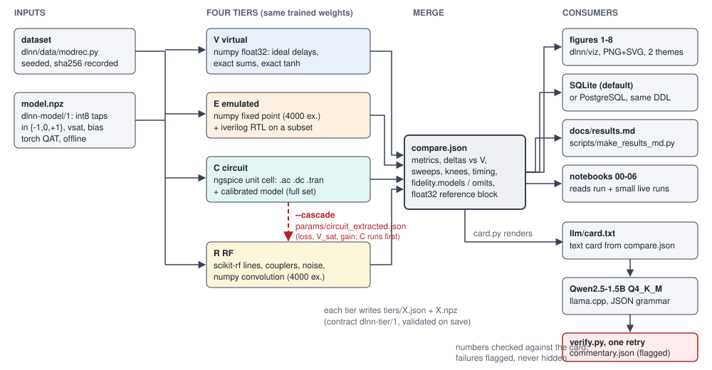

# DLNN: a ternary delay-line neural network, simulated at four fidelities

**Simulation only. Synthetic data. No hardware was built or measured.** Read `honesty.md` before quoting any number.

## The concept in one paragraph

A tapped coaxial delay line with couplers and a combiner computes a convolution; making each tap one of {+1, 0, -1} (coupler, no coupler, coupler through a 180 degree hybrid)
is the ternary weight alphabet of BitNet b1.58, and a bipolar differential pair supplies a native tanh. Three such layers with dilations 1, 4 and 16, a time-average pool and a small
digital readout form a ternary dilated convolutional classifier (`TDL-Net`). This repository trains it offline (PyTorch, ternary QAT) on 8-class modulation recognition with synthetic
I/Q data, then evaluates the **same weights** at four fidelities: **V** ideal math, **E** 8-bit fixed point with Verilog RTL cross-check, **C** ngspice circuit (layer-1 unit cell plus a
circuit-calibrated model), **R** scikit-rf RF channel (loss, dispersion, couplers, noise, saturation). A small local LLM (Qwen2.5-1.5B) writes a number-checked commentary on the side-by-side
results; it is a commentator, not part of the network.

## Headline results

<!-- headline:begin -->
_Generated by `scripts/make_results_md.py` from `out/final-w32/compare.json` (width-32 ternary model, all four tiers on all 4000 test examples, `--cascade`)._

| tier | status | accuracy (4000 test examples) | top-1 agreement vs V |
|---|---|---|---|
| V | ok | 0.863 | 1.000 |
| E | ok | 0.863 | 0.997 |
| C | ok | 0.663 | 0.662 |
| R | ok | 0.701 | 0.709 |
| float32 reference | reference | 0.919 |  |
<!-- headline:end -->

Read this with care. C and R sit 16 to 20 points below V (V 0.863, R 0.701, C 0.663) for **two measured reasons that have to be kept apart**:

1. **The operating point is not buildable.** `--cascade` runs both tiers at the 32 dB per microsecond (RG-58) line loss with no repeaters (the longest layer-3 tap is about 36 dB down). At 0 dB/us they return to about V's level (`results.md`, section 2).
2. **C's default compensation mode over-drives layer 3, and that is most of C's gap.** At the same 32 dB/us, C scores 0.663 with its default `layer` mode (one ideal gain trim per layer), 0.804 with no compensation at all and 0.805 with ideal per-tap repeaters
   (`params/circuit_diagnostics.json`). So about 14 of C's 20 points belong to the per-layer gain-trim modelling choice and only about 6 to the line loss itself. The trim in layer 3 is 2.85x and multiplies the unattenuated short taps too: 72.8 % of C's layer-3 activations are in
   tanh saturation (|tanh| > 0.95), against 49.9 % in V, 31.1 % with no compensation and 50.1 % with per-tap repeaters (4000 test examples; `circuit_extraction.md`, "Where C's gap comes from"). R uses a similar per-layer gain rule and shows the same layer-3 saturation (71.7 %); with ideal per-tap
   equalisation R scores 0.810 instead of 0.701 at 32 dB/us. Whether R's rule is an artefact of the model or what a real amplifier chain would do was not decided.

The width-32 net is the headline; the plan's width-8 net misses its target and is reported next to it (`results.md`, section 4).

## How to run

```bash
./setup.sh                                                   # idempotent; builds llama-cpp-python from source the first time (~4 min)
.venv/bin/python run.py --task modrec --tiers V,E,C,R --cascade --llm none     # about 10 min on 4 cores, no LLM
.venv/bin/python run.py --task modrec --tiers V,E,C,R --cascade --llm qwen     # + Qwen commentary (about 3 min extra)
.venv/bin/python scripts/make_results_md.py --w32 out/<run_id> --w8 out/<w8_run_id>   # regenerate docs/results.md
.venv/bin/python -m dlnn.viz.export --run <run_id> --llm-run <run_id> --secondary <w8_run_id>   # figures -> docs/figures/
DLNN_RUN=out/<run_id> DLNN_LLM_RUN=out/<run_id> .venv/bin/jupyter nbconvert --to notebook --execute --inplace \
    --ExecutePreprocessor.kernel_name=dlnn --ExecutePreprocessor.timeout=900 notebooks/0*.ipynb
.venv/bin/python -m pytest -q
```

Exact commands, versions, hashes and timings of the final run: `reproducibility.md`. More options: `quickstart.md`.

## Map

| Doc | What it is |
|---|---|
| `concept_and_math.md` | layer equations, tap polarity to ternary mapping, tanh diff pair, signal encoding, physical limits, minimal hybrid, why this is a neural net and not an LLM |
| `architecture.md` | repo layout, data contract, tier interface, cascade, pipeline stages, block diagram, Postgres schema |
| `results.md` | generated tables and figures of the final run (`scripts/make_results_md.py`), sweeps, loss/cascade explanation, float vs ternary, w8 vs w32, RTL counts, LLM eval and the real commentary |
| `reproducibility.md` | versions, seeds, hashes, commands, runtimes, hardware |
| `honesty.md` | what is and is not claimed; known gaps; next steps |
| `review.md` | independent review of the documentation, with the response to every finding (M4d) |
| `deviations.md` | planned versus done, per milestone |
| `plan.md` | the original plan (with a banner) |
| `quickstart.md`, `tiers.md`, `contract.md`, `model_export.md`, `fixed_point_spec.md`, `circuit_extraction.md`, `rf_model.md`, `llm_commentary.md`, `llm_eval.md`, `notebooks.md` | component documents written during the milestones |
| `build-log.md`, `build-log-M1.md` ... `build-log-M4b.md` | what each milestone actually ran and measured |

### Notebooks (`notebooks/`, executed, outputs saved; see `notebooks.md`)

| Notebook | Content |
|---|---|
| `00_overview` | concept, tiers, headline table, figure 1 and 7 |
| `01_task_and_model` | the eight signal classes, dataset hash, training report, 8PSK collapse of width 8, weight histograms |
| `02_virtual` | ideal forward pass step by step |
| `03_emulated` | fixed point, ADC and LUT, live RTL vs numpy check |
| `04_circuit` | live ngspice `.dc`, `.ac`, `.tran`; SPICE vs calibrated vs extrapolated; loss compensation modes |
| `05_rf` | scikit-rf lines and tap paths, live sweeps on a subset |
| `06_compare_and_llm` | side-by-side matrix, figures 4-7, card text, commentary with flags |


