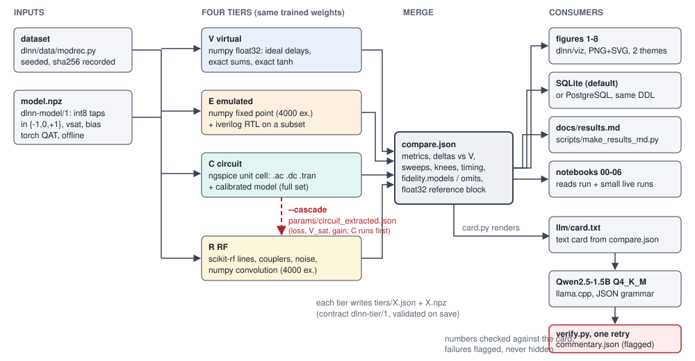

# Architecture



*The pipeline: one dataset and one trained ternary model feed four tiers; C runs before R and hands R its fitted line loss and amplifier scales (`--cascade`);
the tier records merge into `compare.json`, which feeds the figures, the database, the results tables, the notebooks and the LLM card. The commentary keeps
its verification flags.*

## 1. Repository layout

```
run.py                       CLI -> dlnn/pipeline.py
setup.sh, pyproject.toml     environment (idempotent), extras: train rf llm pg dev
dlnn/
  contract.py                tier record + compare schemas, METRIC_IDS, validate/save/load
  pipeline.py                run_pipeline(): dataset+model -> tiers -> compare -> figures -> LLM -> DB
  compare.py  sweeps.py      merge tier records; shared sweep helpers (input AWGN etc.)
  cascade.py                 reads params/circuit_extracted.json, applies it to the RF config
  data/{modrec,narma10}.py   deterministic generators (seeded, sha256-recorded)
  model/                     ternary.py, tdlnet_torch.py, train.py, export.py, npz.py (dlnn-model/1), reservoir.py (NARMA10)
  tiers/{virtual,emulated,circuit,rf}.py    one run(model_npz, dataset, cfg, outdir) -> TierResult each
  llm/                       card.py, prompt.py, backend.py (Null/Qwen/BitNet), verify.py, synth.py, eval.py
  viz/                       figures.py (figs 1-8), common.py, nb.py, export.py, styles/{light,dark}.mplstyle
  db/                        schema.sql, load.py (SQLite and PostgreSQL through one code path)
hw/rtl/                      tdl_layer.v, tb_tdl_layer.v (Icarus Verilog)
hw/spice/                    coax_rg58.lib, diffpair.lib, unit_cell.cir (ngspice 42)
models/                      trained models (.npz), train reports, llm/ (GGUF, eval report; bitnet.cpp checkout)
notebooks/                   00..06 (.ipynb, executed; built by _build.py)
scripts/                     make_results_md.py, r_ideal30.py
tests/                       pytest suite
docs/                        this documentation; figures/
out/<run_id>/                one directory per run (see section 3); out/LATEST names the last run
```

## 2. Data contract (summary; full text in `contract.md`)

* Every tier writes `tiers/<T>.json` (schema `dlnn-tier/1`) and a sibling `.npz`. Required fields include `status` (`ok | skipped | stub | fallback`),
  `tool {name, version}`, `model_sha256`, `dataset_sha256`, `inputs_from`, `n_examples`, `metrics`, `sweeps`, `fidelity {models, omits}`, `runtime_s`, `warnings`.
* `fidelity.omits` is mandatory and non-empty for anything that is not an `ok` ideal tier; a `stub` or `fallback` must say so there and in `warnings`. A tier that fails is
  recorded as `skipped` and the pipeline continues.
* `contract.save` validates before writing, `contract.load` validates on read. `compare.json` (schema `dlnn-compare/1`) is the single input to figures, result tables and the LLM card.
* Metric ids (closed set): `accuracy, macro_f1, acc_per_snr, nmse, top1_agreement_vs_virtual, mean_kl_virtual_vs_tier, logit_nmse_vs_virtual, nmse_vs_virtual`.
* Sweep axes (closed set): `snr_db, adc_bits, loss_db_per_us, tap_amp_err_db, isolation_db`.

## 3. Run directory

```
out/<run_id>/
  args.json  run_meta.json  created_at.txt  timing.json  labels.npy  snr_test.npy  model.npz  reference.json
  tiers/{V,E,C,R}.json (+ .npz)  tiers/E_rtl.json (RTL cross-check detail)
  params/circuit_extracted.json  params/circuit_diagnostics.json     (from tier C)
  spice/*.cir *.log            netlists and ngspice logs
  compare.json                 merged matrix, sweeps, knees, timing, float32 reference block
  figures/                     fig1..fig8, PNG + SVG, light + dark
  llm/card.txt  llm/commentary.json
  dlnn.sqlite
```

## 4. Tier interface

```python
def run(model_npz, dataset, cfg, outdir) -> contract.TierResult
```

All four modules in `dlnn/tiers/` share this signature. Each calls the V forward pass itself to compute the vs-V metrics, so a tier can run on its own. A tier consumes only the
model file, the dataset and `cfg`; the single cross-tier dependency is the cascade below. Tiers: `docs/tiers.md` (what is computed by the real tool and what is calibrated or omitted).

## 5. Cascade (C to R)

With `--cascade`, the pipeline runs C before R. C writes `params/circuit_extracted.json` (schema `dlnn-circuit-extracted/1`: SPICE `.ac` samples of each layer-1 tap, the line fit,
the `.dc` tanh fit, provenance `source`). `dlnn.cascade.apply_to_rf_cfg` copies the **fitted line loss** (about 32 dB/us, the RG-58 figure in the netlist) and the amplifier
`V_sat`/gain/offset scales into R's configuration and adds the file to R's `inputs_from`. The SPICE `tap_H` samples are not injected into R, and the plan's second consumer
(a calibrated V sensitivity check) was not implemented (`deviations.md`). Consequence: with `--cascade`, R's headline sits at the 32 dB/us, no-repeater operating point; R's own
default is 5 dB/us, and both appear in R's loss sweep. Details: `circuit_extraction.md`, `rf_model.md`.

## 6. Pipeline stages (`dlnn/pipeline.py`, timed in `timing.json`)

1. Dataset and model: generate or load the test set (hash recorded), load `models/...npz`; a float or missing file is refused before anything is written.
2. Tiers V, E, C, R in that order (C before R when cascading). A tier that cannot run its real tool falls back and is labelled.
3. Float32 reference: the V code path on the float model of identical topology, stored as `compare.json["reference"]` (`is_tier: false`).
4. `compare.json`, then figures 1-8 (never raise; failures are collected and listed).
5. LLM stage: the backend is constructed **before** the expensive stages (a missing GGUF or wheel is a clear error, never a silent template); `card.py` renders the card from `compare.json`,
   the backend generates grammar-constrained JSON, `verify.py` checks numbers and ids against the card, one retry on mismatch, remaining failures are flagged. `--llm none` writes a template
   commentary that is labelled `source: "template"`.
6. Database: SQLite (default) or PostgreSQL (`--db postgres`, DSN from `--pg-dsn` or `$DLNN_PG_DSN`). JSON files stay canonical.

C and R can run on a fixed stratified subset (`--cr-subset N`, nested in V's and E's test set, with paired deltas against V on the same examples); the default and all runs in `results.md` use the full test set.

## 7. Optional PostgreSQL schema (`dlnn/db/schema.sql`, same DDL for SQLite)

| table | key | content |
|---|---|---|
| `runs` | `run_id` | task, created_at, model and dataset sha256, `args_json`, `compare_json` (TEXT) |
| `tier_results` | `(run_id, tier)` | status, tool name and version, n_examples, runtime_s, `metrics_json`, `fidelity_json`, `inputs_from_json`, `warnings_json` |
| `sweeps` | `(run_id, tier, axis, x)` | accuracy, mean_kl, nmse |
| `predictions` | `(run_id, tier, example_id)` | label, pred, confidence (regression: y_true, y_pred) |
| `llm_outputs` | `(run_id, backend)` | source (`template` or `model`), `output_json`, created_at |

JSON-valued columns are TEXT. The loader replaces a run if it exists. Postgres was verified only against a local throwaway PostgreSQL 16 server (see `honesty.md`); keep credentials out
of files.

## 8. Where each rule lives

| rule | where |
|---|---|
| never present a stub or fallback as the real tool | `contract.py` validation, tier `fidelity.omits`, figure labels |
| nothing is called a SPICE result unless SPICE computed it | C tier `fidelity`, `circuit_extraction.md` |
| the LLM never edits numbers; failures stay visible | `llm/verify.py`, `commentary.json` (`verified`, `unverified[]`) |
| results tables are generated, not typed | `scripts/make_results_md.py` |
